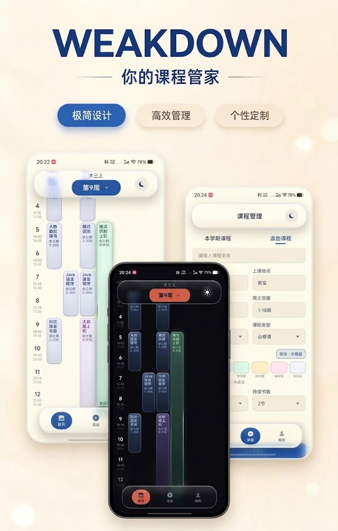
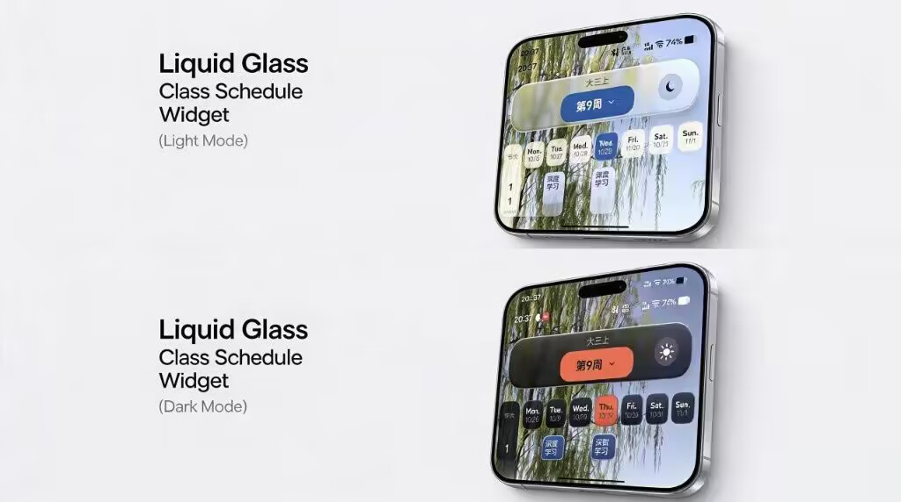

<h1>WEAKDOWN</h1>

<strong>Your class schedule manager</strong> A calmer way to plan your semester.

  
  
  
  

  <a href="README.md">简体中文</a> · <strong>English</strong>

  <a href="#download--install">Download</a> ·
  <a href="#showcase">Showcase</a> ·
  <a href="#usage">Usage</a> ·
  <a href="#open-source">Open Source</a>

## Download & Install

  

| Item | Details |
| --- | --- |
| Latest version | v2.4.2 |
| Requirements | Android 8.0 (API 26) or newer |
| Package | `WEAKDOWN-2.4.2.apk` (~16 MB) |
| Download | [GitHub Releases](https://github.com/AsukaTamo/WEAKDOWN/releases) |

### Installation

1. Open the [Releases](https://github.com/AsukaTamo/WEAKDOWN/releases) page and download the latest APK.
2. When prompted, allow your browser or file manager to install unknown apps.
3. Tap the APK to install, then open the app.
4. To upgrade, install the new APK over the old one. Uninstalling the app removes all local data.

> All courses, semesters and profile data stay on your device. Uninstalling the app or using **Clear data** cannot be undone, so keep a copy of any important timetable.

## Showcase

  

| Schedule | Course management | Personalization |
| :---: | :---: | :---: |
| Week switching · today highlight live course progress | School import · bulk actions copy / move / conflict prompts | Liquid Glass · light & dark wallpaper · time slot templates |

- **Liquid Glass design**: an iris-blue and soft-white light theme, a volcanic-orange and deep-navy dark theme, and the same glass material across cards, bars and sheets.
- **Week at a glance**: switch weeks, highlight today, see progress and time left for the course in progress, and get a heads-up for the next class.
- **Three ways to add**: manual entry, quick add from an empty slot, or importing the timetable page from your school system.
- **Course management**: group by course name, select and delete in bulk, copy a course to the next day, or move it to another time slot with conflict confirmation.
- **Semesters and time slots**: manage multiple semesters, set the total number of weeks, and create multiple time slot templates with per-period start and end times.
- **Personalization**: wallpaper and scrim for the schedule, guide lines, light/dark mode, and a profile card with touch-driven 3D tilt and a radial light sweep.

## Usage

### 1. Set up your semester

Open **Profile → Semester**, create or select the current semester, then set its start date and total number of weeks. Week numbers, today's highlight and course visibility all follow this setting.

### 2. Add courses

- **Quick add**: long-press an empty slot on the schedule and drag across periods to open the quick add form.
- **Manual entry**: tap **+** in the bottom bar → **Manual add** to enter the name, teacher, location, credits, weeks, periods, type, color and notes.
- **School import**: tap **+** → **Import from school system** and capture the timetable page.

### 3. Review and organize

- Tap a course card to see its details, teacher, location and time.
- Long-press a course card to edit, copy, move it to another slot, or delete it.
- Tap **+** → **This semester's courses** to group by course name, multi-select and delete in bulk.

### 4. Import your school timetable

1. Tap **+** → **Import from school system**.
2. Sign in to your school system inside the page and open this semester's timetable.
3. Capture the current page, review the parsed courses, and confirm the import.

> School systems vary a lot. WEAKDOWN currently understands table, div and JSON layouts. If an import fails, feel free to open an [issue](https://github.com/AsukaTamo/WEAKDOWN/issues) with a redacted HTML snippet.

### 5. Make it yours

- Use the sun / moon button in the top bar to switch between light and dark mode.
- **Profile → Schedule background** lets you set a wallpaper, scrim opacity and guide lines.
- **Profile → Time slots** manages multiple templates and per-period class times.
- The profile card tilts in 3D toward your finger with a radial light sweep, then springs back when you let go.

### 6. Data and privacy

- Courses, semesters, time slots and profile data live in a local Room database. No account is required.
- School imports happen inside the in-app WebView; your timetable is not uploaded to a third-party server.
- **Clear data** at the bottom of the Profile page deletes everything locally and cannot be undone.

## Open Source

  

WEAKDOWN is source-available for learning, research and personal use. It is released under the **[PolyForm Noncommercial License 1.0.0](LICENSE)**:

- **Allowed**: personal study, research, teaching, non-commercial projects, modification and redistribution.
- **Not allowed**: any commercial use, including selling the app, paid distribution, bundling it into a commercial product, or republishing it for profit.
- If you distribute or modify the project, keep the [LICENSE](LICENSE) and copyright notice.

> Note: PolyForm Noncommercial is a source-available, non-commercial license and is not an OSI-approved open source license. The Open Source badge at the top communicates that the source is public; it does not change the license terms.

Third-party components (Jetpack Compose, AndroidX, Vitro and others) keep their own licenses. The Apache 2.0 text for Vitro is available in [LICENSE-vitro.txt](app/src/main/java/io/LICENSE-vitro.txt).

## Support WEAKDOWN

If WEAKDOWN helps you, share it with a classmate or buy the author a coffee.

  

<strong>WeChat tip QR</strong> (mainland China)

  
   
  Scan with WeChat · voluntary tips only

> The Buy Me a Coffee link is coming soon. Until then, sharing the project or sending feedback is the best support.

Found a bug or have an idea? Open a [GitHub Issue](https://github.com/AsukaTamo/WEAKDOWN/issues).

  WEAKDOWN · A calmer way to plan your semester.

